<div align="center">





**[🚪 방_01.exe 실행하기 — 픽셀 방탈출](https://choliea.github.io/game/)**

</div>

---

### 🖥️ 시스템 정보

```ini
[사용자 정보]
이름 = 생략
직업 = 여기서는 중요하지 않음
주요 기능 = 생각난 거 해보기
설치 목적 = 기억나지 않음
현재 상태 = 확인 중
```

> 시스템은 정상적으로 시작되었습니다. 무엇을 시작했는지는 확인 중입니다.

<details>
<summary>🖱️ <b>바탕화면의 수상한 바로가기</b></summary>

```text
바로가기 이름: 이것만_하고_잘게.lnk
대상: 알 수 없음
마지막 실행: 어제
마지막 종료: 기록 없음
```

> [힌트] 종료 기록이 없다고 해서 아직 하고 있다는 뜻은 아닙니다. 아마도.

</details>

### 📁 내 컴퓨터

```text
내 컴퓨터/
├─ 만들고 싶은 것/
│  ├─ 지금 만드는 것/
│  │  └─ 만들다가 생각난 것/
│  │     └─ 이게 더 재밌을 것 같은데/
│  └─ 언젠가는.txt
├─ 게임/
│  └─ 한 판만 더.exe
├─ 방탈출/
│  ├─ 예약_확인_진짜최종.txt
│  └─ 힌트는_안_볼_거야.txt
├─ 완성한 것/
│  └─ 분명_어딘가에_있음.url
└─ 휴지통/
   └─ 지우면_생각날_아이디어.txt
```

### 📟 최근 시스템 로그

```log
[09:41] 괜찮은 생각 발견
[09:42] 기존 작업 일시 중지
[09:43] 새 작업 생성
[09:44] 이름을 정하는 중
[10:17] 이름 결정
[10:18] 이름 변경
[10:19] 이름 변경
[10:20] 이름 변경
[10:21] 일단 저장
[10:22] 뭐 하려고 했더라
[10:23] 정상 작동 중
```

### 🎮 플레이어 상태

| 항목 | 상태 |
| :-- | :-- |
| 메인 퀘스트 | 아직 수락하지 않음 |
| 서브 퀘스트 | 자동 수락 중 |
| 인벤토리 | 아이디어로 가득 참 |
| 최근 방문 지역 | 컴퓨터 앞 |
| 선호 콘텐츠 | 게임 · 방탈출 · 이것저것 |
| 저장 여부 | 아마도 |

<details>
<summary>🔒 <b>관리자 전용: 열지 마세요</b></summary>
<br />

접근이 허용되었습니다.

관리자 권한을 확인하지 않았기 때문입니다.

**첫 번째 단서: `아무튼`**

<sub>※ 다른 단서도 어딘가에 있습니다. 시스템은 위치를 알려줄 의무가 없습니다.</sub>
</details>

<details>
<summary>🧩 <b>진단 도구 실행</b></summary>
<br />

```text
진단을 시작합니다.
[✓] 호기심 감지
[✓] 쓸데없는 기능 감지
[✓] 방금 다른 생각 한 기록 감지
[?] 원래 하던 일 감지 실패

진단 결과: 특이 사항 없음
```

**두 번째 단서: `실행`**
</details>

<details>
<summary>🗑️ <b>휴지통 (비어 있음)</b></summary>
<br />

휴지통이 비어 있지 않습니다.

```text
삭제된 파일: 계획표_최종.xlsx
복원 가능 여부: 불명
삭제 사유: 계획을 세우느라 할 일을 못 함
```

**세 번째 단서: `중`**
</details>

<details>
<summary>🔐 <b>숨겨진 파일: 세 단서를 순서대로 연결한 문장을 알고 있다면 열기</b></summary>
<br />

> **아무튼 실행 중**
>
> 정답입니다. 보상으로 아무 일도 일어나지 않습니다.

```text
[업적 달성] 굳이 여기까지 확인함
보상: 없음
소요 시간: 돌려드릴 수 없음
```

이 문서를 닫아도 시스템은 계속 실행됩니다.
</details>

---

<div align="center">

```text
┌─────────────────────────────────────────┐
│  새로운 생각이 감지되었습니다.         │
│                                         │
│  현재 하던 일을 계속하시겠습니까?      │
│                                         │
│       [나중에]        [새로 시작]       │
│                                         │
│  ※ 선택과 관계없이 새 창이 열립니다.   │
└─────────────────────────────────────────┘
```

<sub>© 아무튼 실행 중 · 업데이트 주기 미정 · 종료 버튼 없음</sub>

</div>
